# How to use Helpers

Helpers sits in the corner of your screen and helps you read, write and think things through. This guide shows each part, one step at a time.

## At a glance

| You want to | Do this |
|---|---|
| Hear some text | Select it, then press **Read** on the button by your mouse. Or press **Ctrl+Alt+Space**. |
| Stop the voice | Press **Ctrl+Alt+Space** with nothing selected, or **Stop** in the player. |
| Write a reply | Press **Ctrl+Alt+C** in the app you're writing in. Compose opens. |
| Fix something you've already written | Select it, press **Edit**, fix it in Compose, then press **Put it back**. |
| Get a reader's notes on your draft | Press **Check my thinking** in Compose. |
| Look up a word | Right-click it in Compose and choose **Look up**. |
| Change how anything works | Click the Helpers icon by the clock, then **Settings**. |

## Getting started

Download Helpers from the [Releases page](https://github.com/drhumphrey/helpers/releases) and run the installer. It installs for you only and doesn't need admin rights. The [README](../README.md#install) has the details.

The first time Helpers starts, it asks three things:

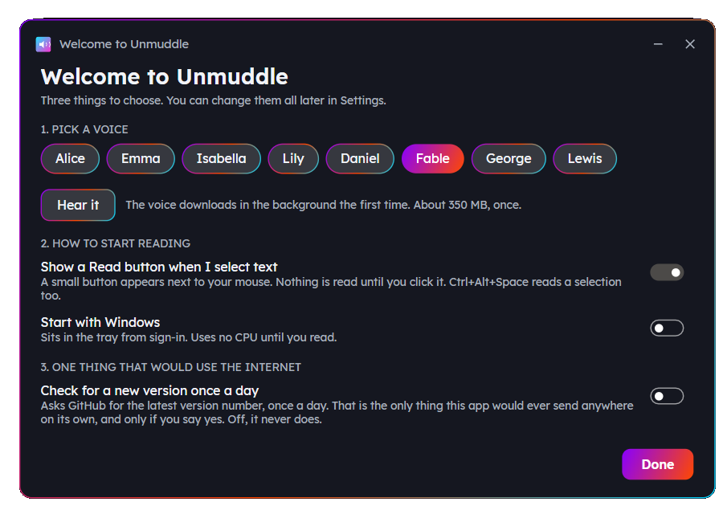

1. **Pick a voice.** Press **Hear it** to try one. The voice downloads the first time, about 350 MB, then works offline.
2. **How to start reading.** The Read button and starting with Windows are both up to you.
3. **Updates.** If you switch this on, Helpers asks GitHub once a day whether there's a newer version. Nothing else is ever sent.

Press **Done**. Helpers now lives in the notification area by the clock. If you can't see its icon, click the small arrow there.

Click the icon to open the Helpers menu:

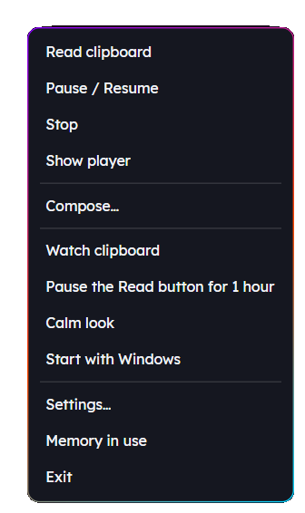

Right-click the icon for the same things in a plain menu.

## Hear it

### With the Read button

1. Select some text in any app. Drag over it, double-click a word, or triple-click a paragraph.
2. A small button appears next to your mouse.
3. Press **Read**.

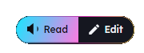

The button disappears by itself if you don't use it. It has up to three parts:

- **Read** reads the selection aloud.
- **Edit** opens the selection in Compose (see [Edit and put it back](#edit-and-put-it-back)).
- **Paste** appears when you've copied some text. It pastes that text over your selection.

### With the keyboard

Select text and press **Ctrl+Alt+Space**. Press it again with nothing selected to stop.

### The player

While Helpers reads, the player shows the sentence it's on and highlights each word as it's spoken.

From left to right: **play or pause**, **back one sentence**, **forward one sentence**, **stop**, then the speed, the voice, **the reading view**, Settings and **hide**.

Open the reading view to see the whole text. The current sentence and word are highlighted. Click any sentence to jump to it.

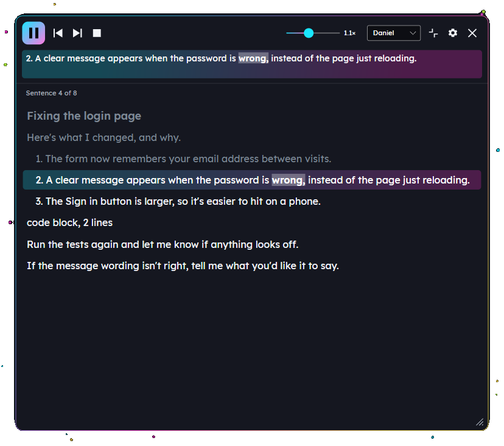

### What gets read, and how

Helpers understands the Markdown that AI chats write. It says "code block, 12 lines" instead of reading code out letter by letter. It doesn't read web addresses out in full. Years, prices, times and percentages are said the way people say them.

If the voice says a word wrongly, teach it: go to **Settings**, then **Reading**, then **Pronunciations**. Type the word, type how to say it, and press **Add**.

## Write it

Compose is a calm place to write. Open it in any of these ways:

- Press **Ctrl+Alt+C** in the app you're writing in.
- Press **Edit** on the Read button.
- Choose **Compose** from the Helpers menu.

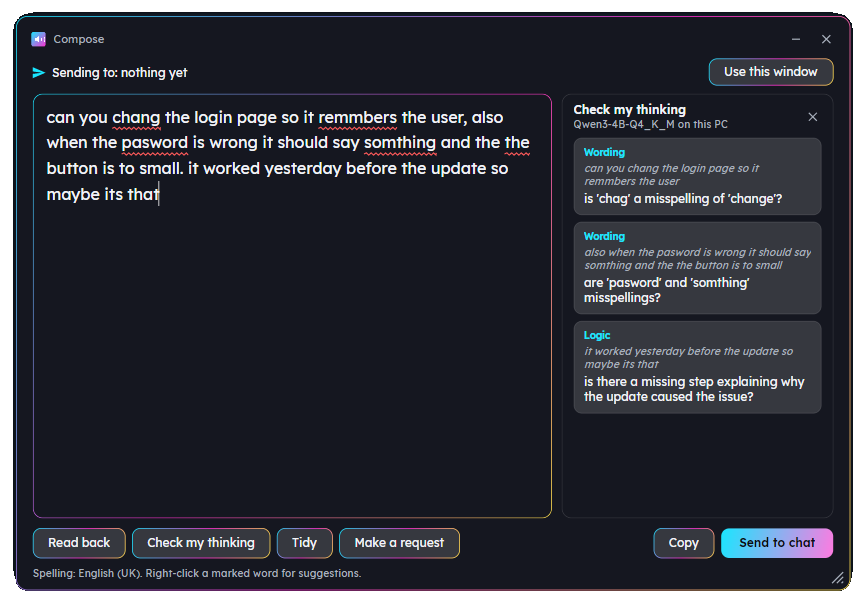

- **Spelling.** Words that may be misspelled get a red underline as you type. Right-click one for suggestions, or to add it to your dictionary.
- **Read back** reads your draft to you. Hearing it catches mistakes a spell checker can't, like "form" for "from".
- **Send to chat** pastes your draft into the app shown at the top, next to "Sending to". It never presses Enter, so you send it when you're ready. Whatever you had copied stays on the clipboard.
- **Use this window** changes where your draft goes. Press it, then click the window you want.
- **Copy** puts the draft on the clipboard.

Your draft saves itself as you type. Close Compose and it's still there next time.

### Edit and put it back

Use this to fix something you've half written in another app.

1. Select your text in that app.
2. Press **Edit** on the Read button.
3. Fix it in Compose.
4. Press **Put it back**. Your new text replaces the old selection.

## Shape it

Helpers can give you a reader's notes on your draft. This is optional, and off until you choose an AI helper.

### Choose an AI helper

Go to **Settings**, then **AI**.

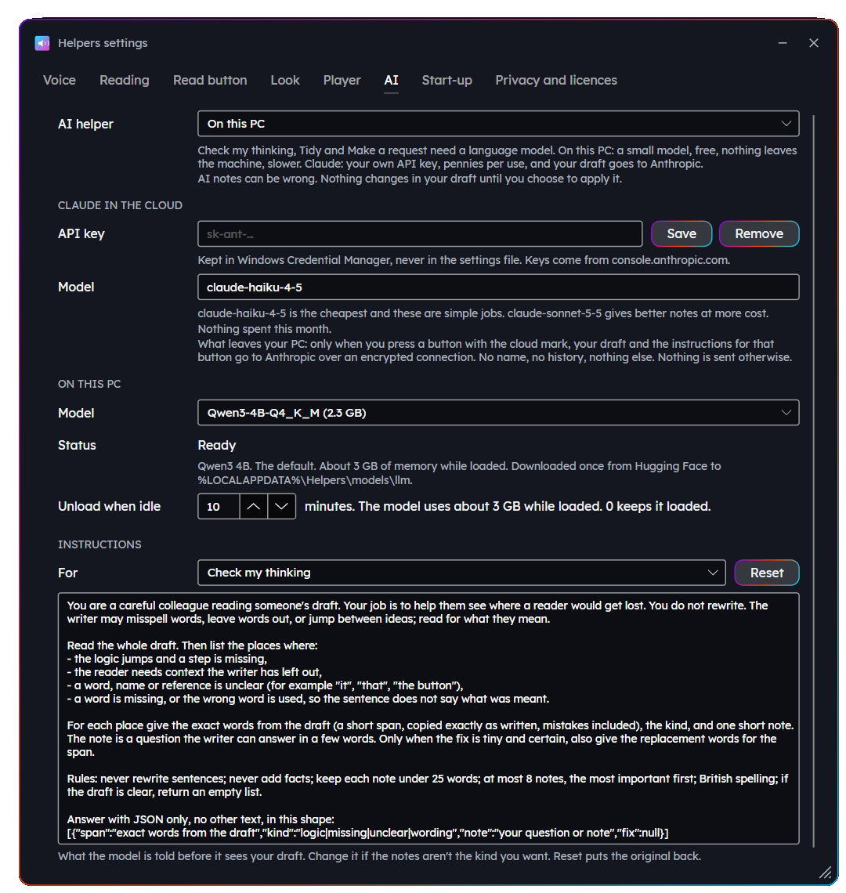

| | On this PC | Claude in the cloud |
|---|---|---|
| Cost | Free | Your own API key. Usually less than a penny a time. |
| Privacy | Nothing leaves your PC | Your draft goes to Anthropic, only when you press a button with the cloud mark |
| Speed | 10 to 20 seconds | A few seconds |
| Download | 2.5 GB, once | None |

For Claude, get a key from [console.anthropic.com](https://console.anthropic.com), paste it in and press **Save**. Helpers keeps it in Windows Credential Manager, never in a file. The first time you use Claude, Helpers shows you exactly what it will send.

### The three buttons in Compose

- **Check my thinking.** A careful reader's notes: where the logic jumps, what's missing, which "it" you mean. Each note is a question or a tiny fix, pinned to your words. Click a note to see the words it's about. A fix only happens if you press **Apply**. Helpers never rewrites your text.
- **Tidy.** Spelling and grammar only. Every change is marked, and you apply them one at a time.
- **Make a request.** Turns rough notes into a clear request for an AI coding assistant. Press **Use this** to put it in Compose, or **Copy** it.

AI notes can be wrong. You decide what to change.

The instructions each button gives the AI are at the bottom of the AI page. You can change them. **Reset** puts the original back.

## Look up a word

Right-click any word in Compose and choose **Look up**.

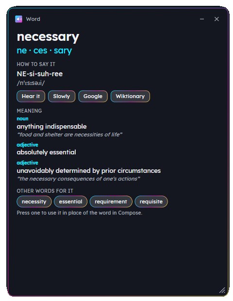

You get:

- the word in syllables
- how to say it, in plain letters and in phonetic symbols
- **Hear it** and **Slowly**
- what it means, with an example
- other words with the same meaning. Press one to swap it into your draft.

The dictionary downloads the first time, about 10 MB. For names and new words, **Google** and **Wiktionary** open in your browser.

## Make it yours

Everything is in **Settings**. Click the Helpers icon, then **Settings**. Changes apply straight away.

**Voice:** the voice, speed and volume, and which speakers to use.

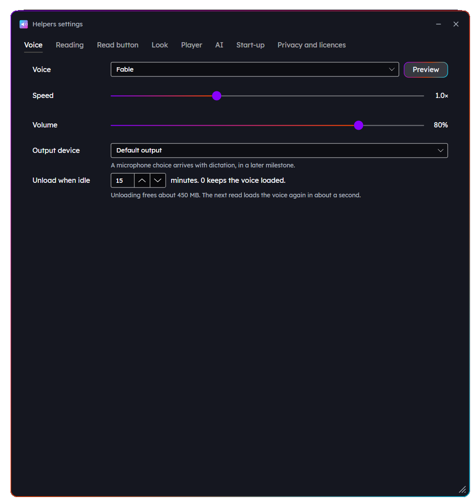

**Reading:** the font, size, line spacing and background tint for reading, what gets said for code, links and tables, and your pronunciations. Lexend and Atkinson Hyperlegible are fonts designed to be easy to read.

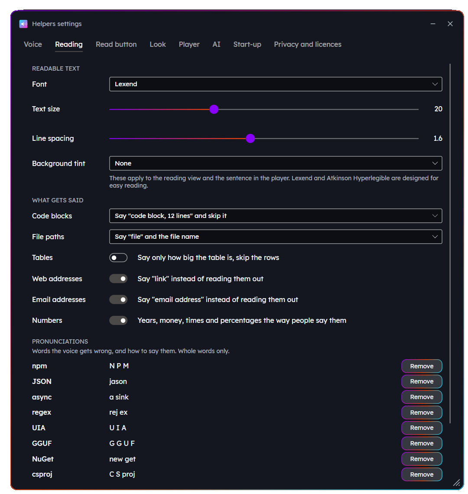

**Read button:** whether the button appears, how quickly, the apps it never appears in, and the two shortcuts. Password managers are left out to start with. If a shortcut types a character instead of working, pick another: on some keyboards Ctrl+Alt is the same as AltGr.

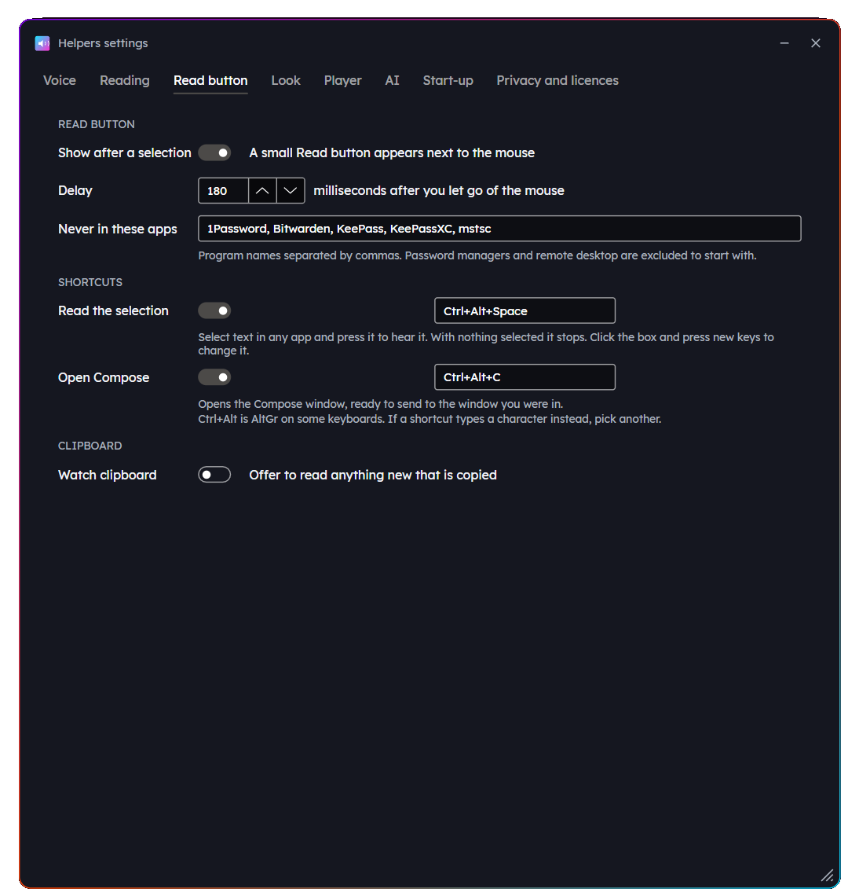

**Look:** the style. **Neon** and **Custom colours** are dark and colourful. **Calm** is quiet, and can follow Windows' light or dark setting. **Size** makes everything bigger or smaller.

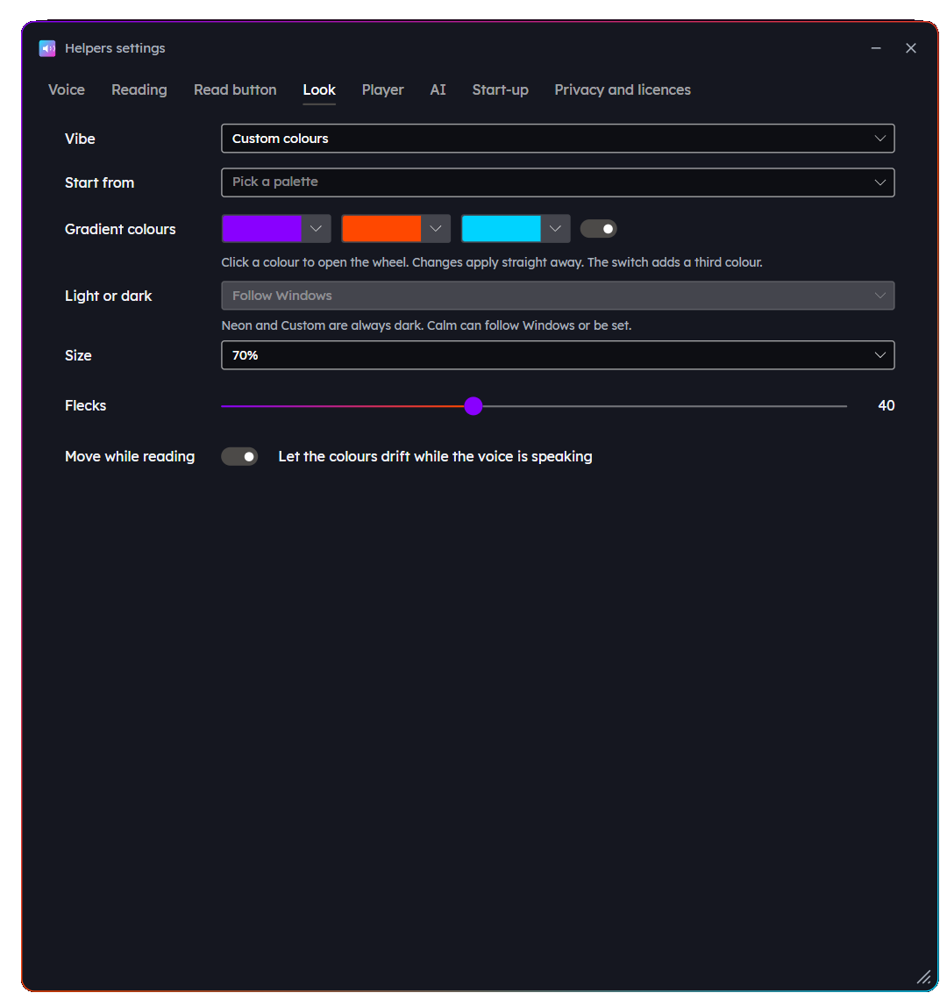

**Player:** how long the player stays after reading, and which screen messages appear on.

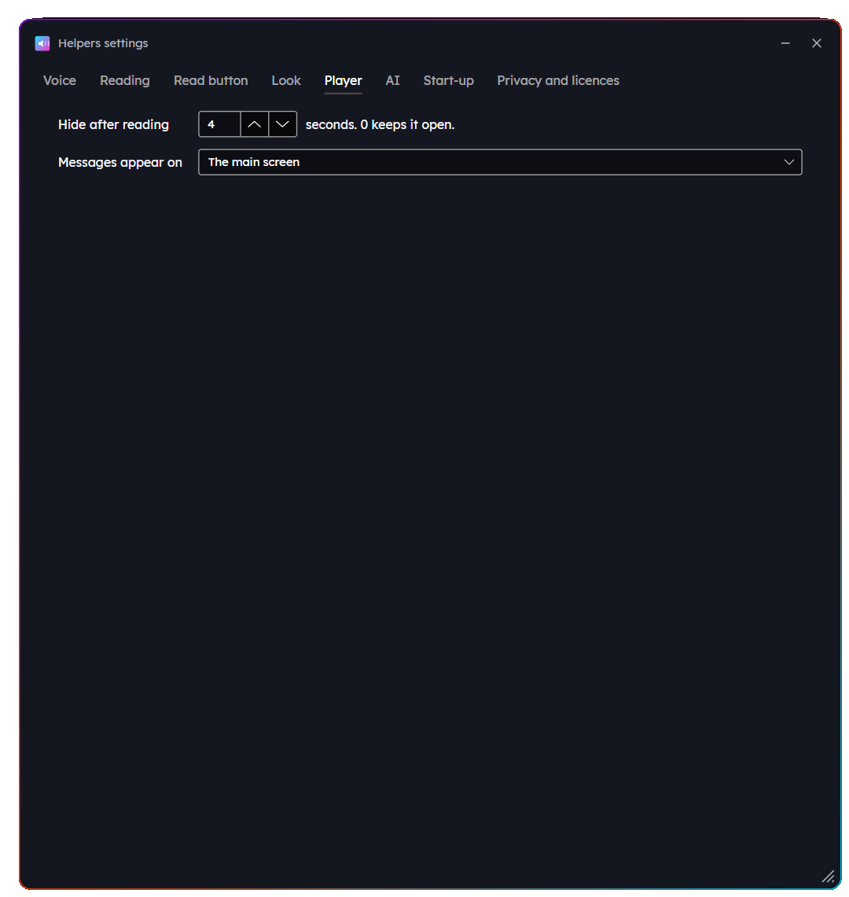

**Start-up:** whether Helpers starts when you sign in.

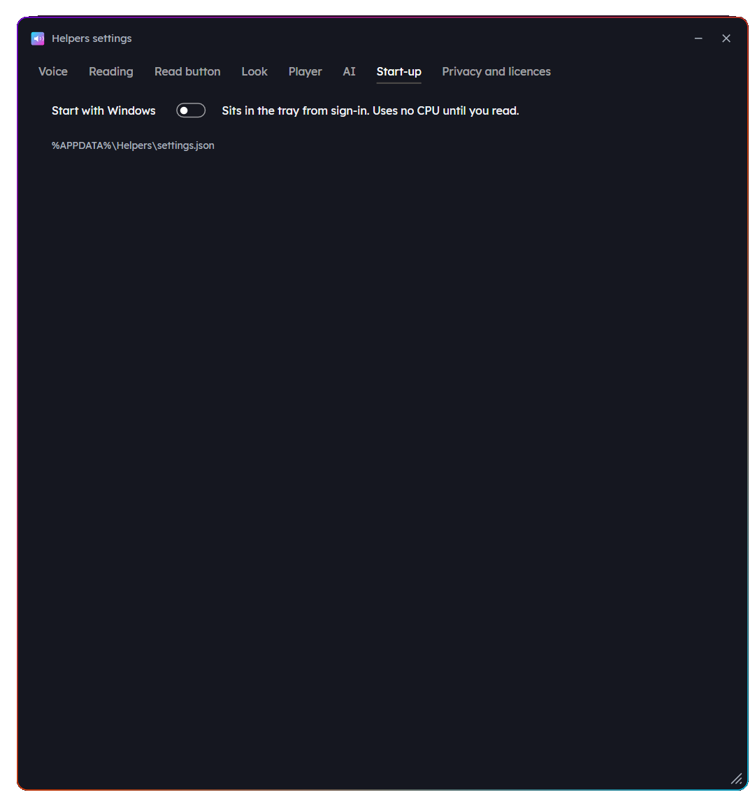

**Privacy and licences:** what leaves your PC, the update check, and every part Helpers is built with, with its licence.

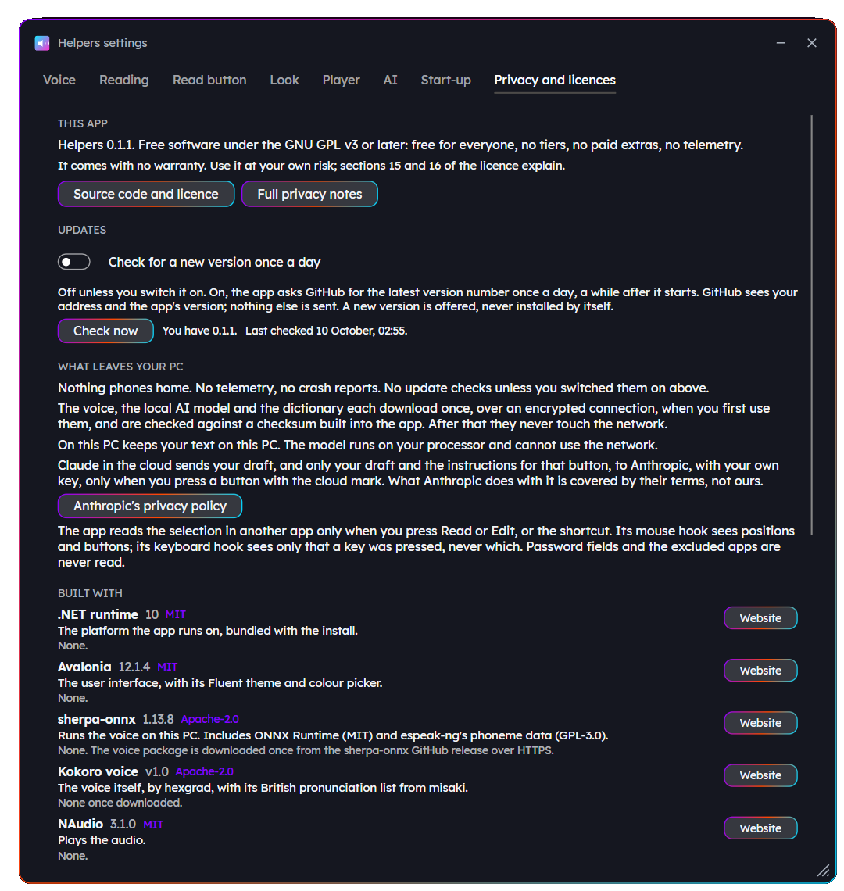

## Updates

Helpers only looks for updates if you switch it on, on the welcome screen or under **Settings**, then **Privacy and licences**. Press **Check now** to look straight away.

When there's a new version, a message offers it. Press **See what's new**, then:

- **Update now** downloads it, checks it, installs it quietly and starts Helpers again. It takes about half a minute.
- **Skip this version** stops Helpers offering this one.
- **Not now** asks again another day.

If you have version 0.1.0, install the next version by hand from the [Releases page](https://github.com/drhumphrey/helpers/releases). Update now doesn't work in 0.1.0.

## If something isn't working

**Windows says "Windows protected your PC".** Helpers isn't code-signed yet. Choose **More info**, then **Run anyway**.

**Windows blocks Helpers and doesn't offer Run anyway.** That's Smart App Control, which blocks apps that aren't code-signed. We're working on signing. Until then the only way past it is to turn Smart App Control off in Windows Security, and on some versions of Windows it can't be turned back on.

**A shortcut does nothing.** Only one copy of Helpers can use the shortcuts. Check there isn't a second copy running. If a shortcut types a character instead, choose another under **Settings**, then **Read button**.

**No red underlines in Compose.** Windows' spell checker needs the English (United Kingdom) language. Add it in Windows Settings, under **Time & language**, then **Language & region**. The line at the bottom of Compose says whether spelling is on.

**The Read button doesn't appear in an app.** Check it isn't on the list under **Settings**, then **Read button**. Helpers never reads password boxes. It also can't read from apps that run as administrator, and it tells you when that happens.

**The AI takes a while the first time.** On this PC, the model loads first. After that, each press takes 10 to 20 seconds. Claude takes a few seconds.

**Where Helpers keeps things.** Settings and your draft: `%APPDATA%\Helpers\settings.json`. The voice, the AI model and the dictionary: `%LOCALAPPDATA%\Helpers\models`. Uninstalling leaves both, so a reinstall keeps your settings.

Still stuck? Tell us in an [issue](https://github.com/drhumphrey/helpers/issues). Please make up an example rather than pasting private text.
